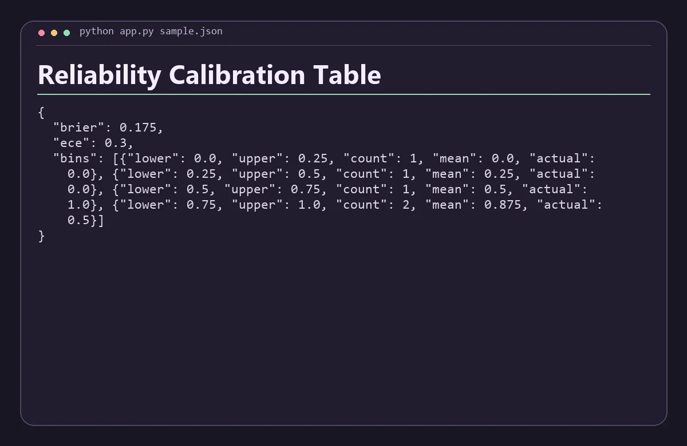

# Reliability Calibration Table

Compare predicted probabilities with observed outcomes and report Brier score and calibration error.



## Run

Install Python 3.11 or newer. Run these commands from the repository root.

```sh
python app.py sample.json
```

Replace `sample.json` with a JSON file following the same structure. The app prints a JSON report to standard output.

Enter binary outcomes as 0 or 1. A probability of 1 belongs in the last bin. Empty bins are omitted. ECE weights each occupied bin by its share of predictions.

## Verify

Run `python check.py` with Python 3.11 or newer after the build step when applicable. The check verifies the bundled scenario and confirms that an invalid input returns an error.
